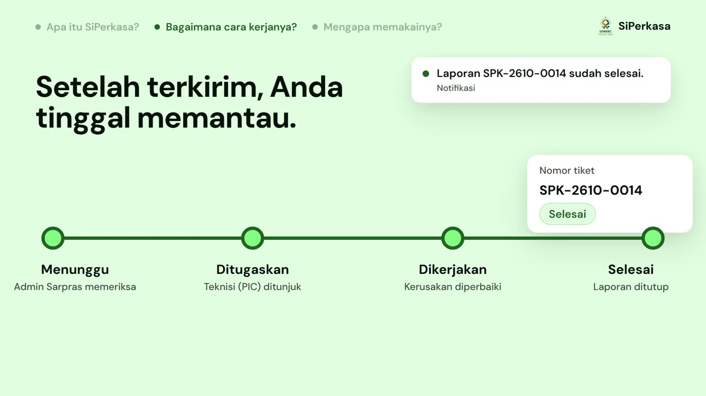

# SiPerkasa

**Laporkan kerusakan fasilitas kampus, pantau sampai selesai.**

Aplikasi pelaporan kerusakan fasilitas dan aset untuk UIN Siber Syekh Nurjati Cirebon. Foto kerusakannya dari HP dan kirim. Admin Sarpras memvalidasi, teknisi mengerjakan, dan setiap perubahan status tercatat di laporan Anda.

## Apa itu SiPerkasa

SiPerkasa mengumpulkan seluruh proses penanganan kerusakan fasilitas dalam satu tempat. Pelapor memilih aset dan lokasi, menjelaskan kerusakannya, lalu melampirkan foto. Laporan kemudian melewati tahap yang sama untuk semua orang, sehingga selalu jelas siapa yang sedang memegangnya.

## Kenapa SiPerkasa

- **Bukti dan jejak.** Semua yang terjadi pada sebuah laporan tersimpan di laporan itu sendiri, bukan di grup pesan.
- **Jelas siapa memegang apa.** Pelapor, Admin Sarpras, dan teknisi punya peran dan menu masing-masing.
- **Tidak ada laporan yang diam.** Prioritas dan target selesai ditetapkan, dan laporan yang melewati target ditandai.
- **Kabar langsung.** Perubahan status masuk ke notifikasi di aplikasi.

## Fitur utama

- **Foto sebelum dan sesudah.** Pelapor melampirkan 1 sampai 3 foto kerusakan. Teknisi melampirkan foto hasil perbaikan saat menutup laporan.
- **Prioritas dan target selesai.** Admin Sarpras menetapkan prioritas, dan target selesai mengikuti prioritas itu.
- **Riwayat status.** Setiap perubahan status tercatat bersama waktu, pelaku, dan catatannya.
- **Notifikasi di aplikasi.** Admin Sarpras mendapat kabar saat ada laporan baru, teknisi saat menerima tugas, dan pelapor setiap kali status laporannya berubah.
- **Rekap dan ekspor.** Admin melihat ringkasan laporan di dashboard dan mengekspor datanya ke Excel atau PDF.
- **Data master.** Admin mengelola aset, kategori, serta gedung dan ruang.
- **Impor aset dan pengguna.** Data aset (BMN) dan pengguna dapat diimpor dari berkas.

## Alur laporan

Setiap laporan melewati empat tahap utama.

1. **Lapor (Pelapor).** Pilih aset dan lokasinya, jelaskan kerusakannya, lalu lampirkan foto dari kamera HP. Status: **Menunggu**.
2. **Validasi (Admin Sarpras).** Laporan diperiksa, diberi prioritas dan target selesai, lalu ditugaskan ke teknisi. Laporan yang tidak sesuai ditolak dengan alasan. Status: **Ditugaskan** atau **Ditolak**.
3. **Dikerjakan (PIC teknisi).** Teknisi menandai laporan sedang dikerjakan dan mencatat kendala bila perbaikan harus ditunda. Status: **Dikerjakan** atau **Ditunda**.
4. **Selesai (PIC teknisi).** Teknisi menutup laporan dengan foto hasil perbaikan, dan pelapor menerima notifikasi. Status: **Selesai**.

Pelapor juga dapat mengubah atau membatalkan laporan selama belum divalidasi. Status lain yang dikenal sistem: **Dibatalkan**.

## Peran pengguna

| Peran | Siapa | Yang dilakukan |
| --- | --- | --- |
| **Pelapor** | Mahasiswa, dosen, dan tenaga kependidikan | Melapor kerusakan dengan foto, mengubah atau membatalkan laporan selama belum divalidasi, memantau status dan menerima notifikasi. Menu: Beranda, Laporan Saya, Buat Laporan, Notifikasi. |
| **Admin Sarpras** | Tim Sarana dan Prasarana | Memvalidasi atau menolak laporan, menetapkan prioritas, target selesai, dan PIC, melihat rekap dan mengekspor data. Menu: Beranda, Laporan, Notifikasi, Aset, Impor Aset, Kategori, Gedung & Ruang, Pengguna. |
| **PIC teknisi** | Teknisi penanggung jawab perbaikan | Melihat daftar tugas perbaikan, memperbarui status dan mencatat kendala, menutup laporan dengan foto hasil perbaikan. Menu: Beranda, Tugas, Notifikasi. |

## Keamanan dan akses

- Masuk dengan NIM atau NIP. Mahasiswa dan dosen dapat memakai akun kampus.
- Login dengan **passkey** sebagai alternatif password.
- **Autentikasi dua faktor (2FA)** tersedia untuk akun.
- Aksi sensitif pada pengaturan keamanan meminta konfirmasi password.
- Akses dibatasi per peran: Pelapor, PIC, dan Admin hanya melihat menu dan data yang menjadi bagiannya.

## Dibangun dengan

Autentikasi memakai Laravel Fortify (passkey dan 2FA). Ekspor PDF memakai Dompdf dan ekspor Excel memakai OpenSpout.

---

SiPerkasa: sistem pelaporan kerusakan fasilitas kampus, UIN Siber Syekh Nurjati Cirebon.
